<p align="center">
  
</p>

<h1 align="center">Servant</h1>

<p align="center">
  <b>Your personal data hub, on your own server.</b><br>
  Apps, data, and files in one interoperable place
</p>

<p align="center">
  <a href="#quick-start">Quick start</a> ·
  <a href="#screenshots">Screenshots</a> ·
  <a href="#documentation">Documentation</a>
</p>

<a href="docs/screenshots/dashboard.webp">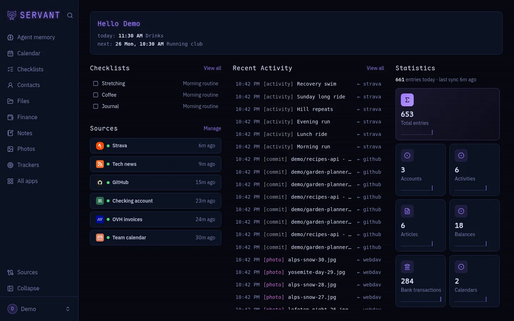</a>

## Why Servant

- **All your data in one place:** contacts, calendar, notes, photos, files, checklists,
  trackers and finance.
- **Fed by your services:** bank, Apple Health, Strava, GitHub, RSS and iCal feeds, crypto
  wallets and more, synced on a schedule.
- **On your phone, without Google or iCloud:** two-way calendar and contact sync, camera roll
  backup.
- **Open to your tools:** a REST API with scoped tokens, live updates over websockets, one
  shared memory for Claude Code and Cursor.
- **Extensible:** install apps from git, or describe one and let an agent write it.
- **Light and private:** one server, one SQLite file, Docker or bare metal. It runs on
  a Raspberry Pi.

## Quick start

```bash
echo "SECRET_KEY_BASE=$(openssl rand -base64 48)" >> .env
echo "PHX_HOST=localhost" >> .env
docker compose up -d --build
```

Open `http://localhost:4000` and register the first account. More in the
[deployment guide](docs/deploy.md).

## Documentation

| I want to... | Read |
|--------------|------|
| Install Servant on a server | [Deployment](docs/deploy.md) |
| Save my data | [Backups](docs/backup-strategy.md) |
| See my calendars and contacts on my phone | [Phone sync](docs/dav.md) |
| Back up my phone's photos automatically | [Phone backup](docs/phone-backup.md) |
| Share photos with a link | [Photo sharing](docs/photo-sharing.md) |
| Add an app that Servant does not have | [Custom apps](docs/custom-apps.md) |
| Give Claude Code and Cursor one shared memory | [Agent memory](docs/agent-memory.md) |
| Develop on Servant | [Development](docs/development.md) and the [coding rules](AGENTS.md) |


## Screenshots

<table>
  <tr>
    <td width="50%"><a href="docs/screenshots/calendar.webp">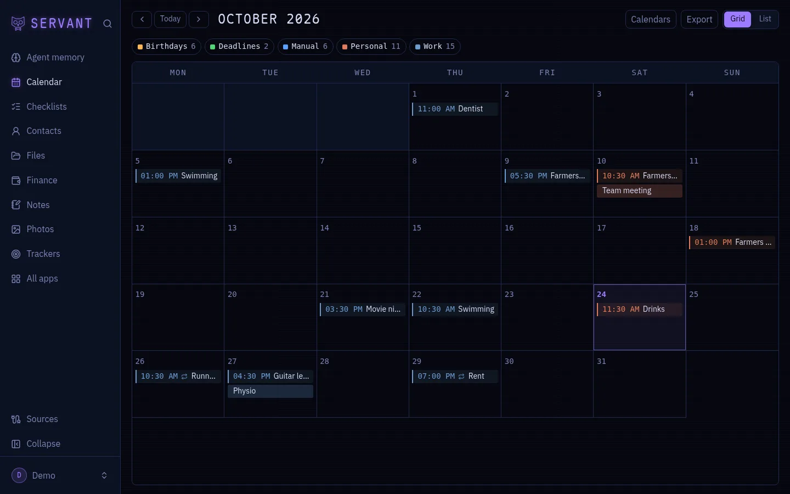</a><br><sub><b>Calendar</b>: month grid with agendas, birthdays and deadlines</sub></td>
    <td width="50%"><a href="docs/screenshots/contacts.webp">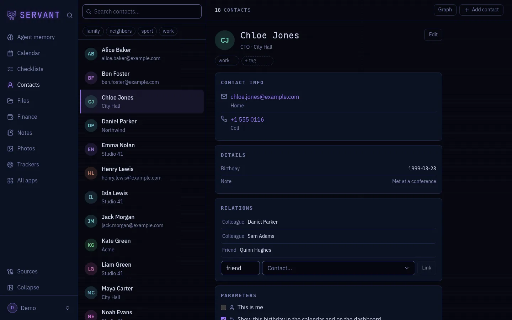</a><br><sub><b>Contacts</b>: cards with relations, events and birthdays</sub></td>
  </tr>
  <tr>
    <td width="50%"><a href="docs/screenshots/contacts-graph.webp">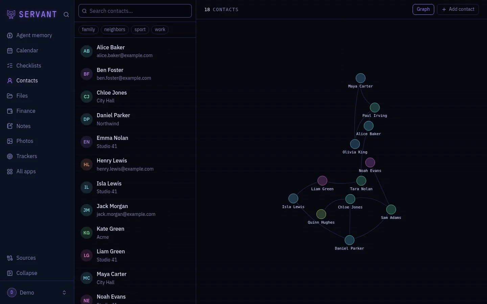</a><br><sub><b>Contacts graph</b>: the relations between people</sub></td>
    <td width="50%"><a href="docs/screenshots/notes.webp">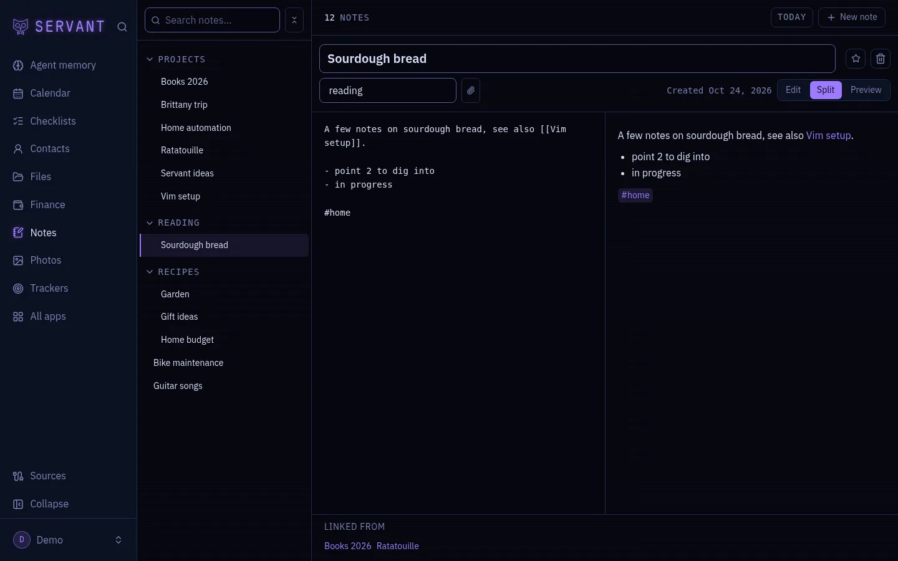</a><br><sub><b>Notes</b>: markdown with wikilinks, split edit and preview</sub></td>
  </tr>
  <tr>
    <td width="50%"><a href="docs/screenshots/photos.webp">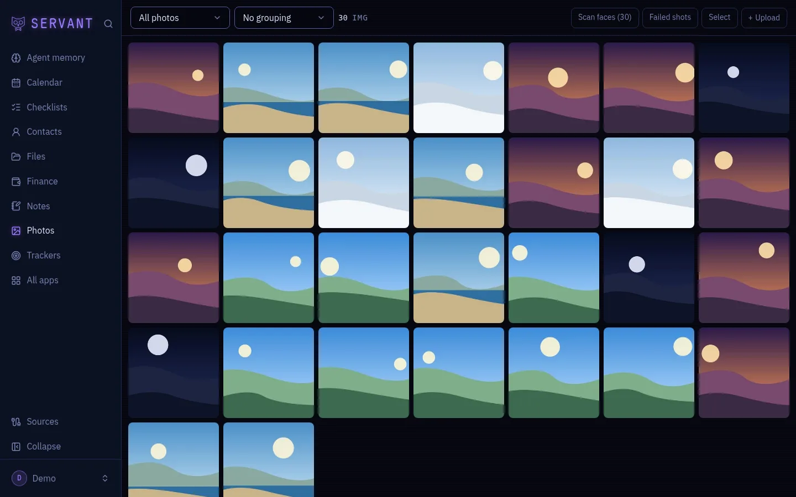</a><br><sub><b>Photos</b>: gallery, faces, share links, failed shots</sub></td>
    <td width="50%"><a href="docs/screenshots/files.webp">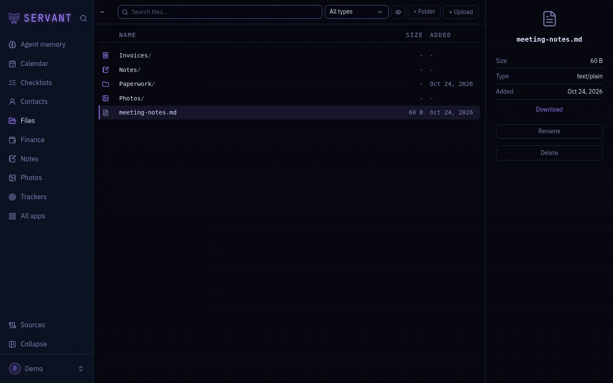</a><br><sub><b>Files</b>: storage with virtual Notes, Photos and Invoices folders</sub></td>
  </tr>
  <tr>
    <td width="50%"><a href="docs/screenshots/finance.webp">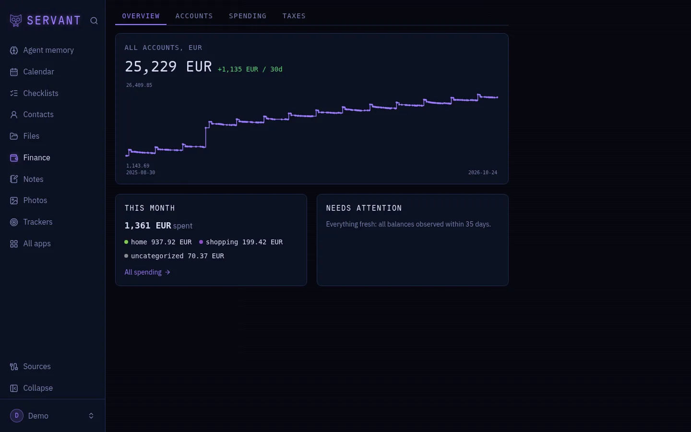</a><br><sub><b>Finance</b>: net worth, spending and taxes</sub></td>
    <td width="50%"><a href="docs/screenshots/trackers.webp">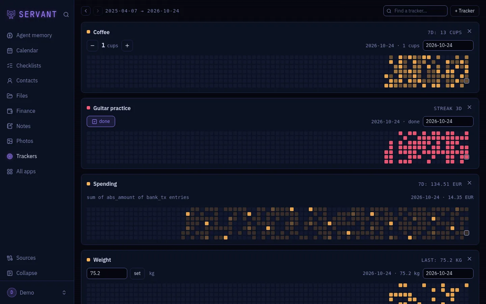</a><br><sub><b>Trackers</b>: habits and metrics as heatmaps</sub></td>
  </tr>
  <tr>
    <td width="50%"><a href="docs/screenshots/checklists.webp">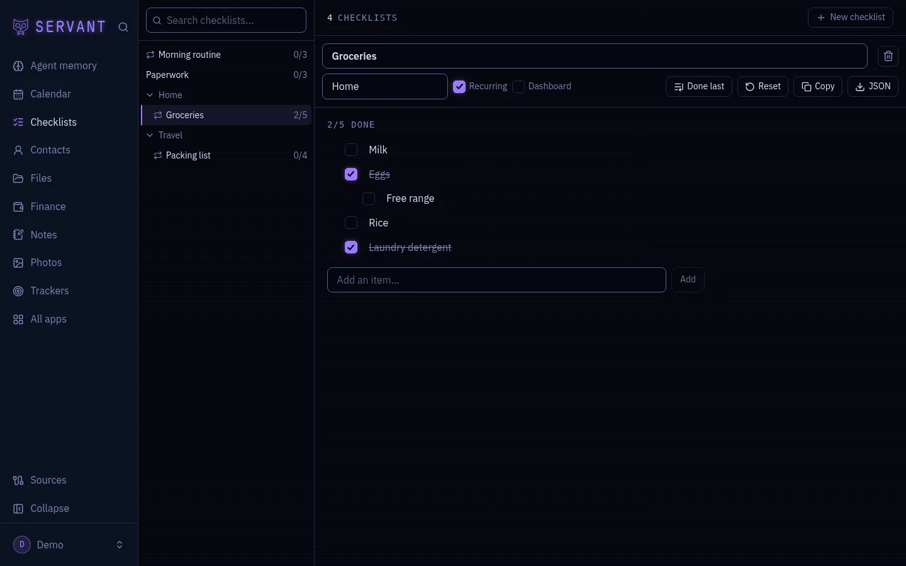</a><br><sub><b>Checklists</b>: recurring lists with nested items</sub></td>
    <td width="50%"><a href="docs/screenshots/sources.webp">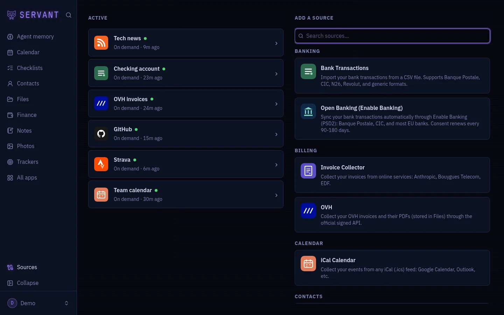</a><br><sub><b>Sources</b>: connectors syncing external services</sub></td>
  </tr>
  <tr>
    <td width="50%"><a href="docs/screenshots/agent-memory.webp">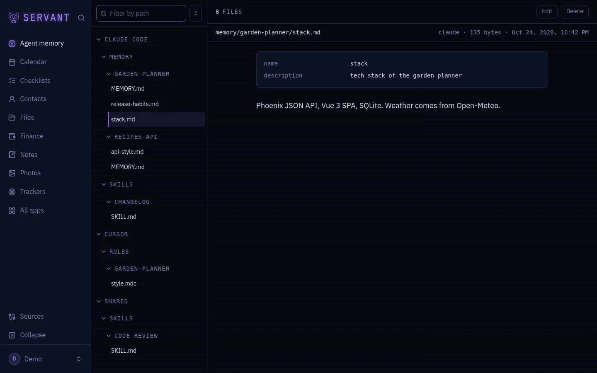</a><br><sub><b>Agent memory</b>: Claude Code and Cursor memory and skills</sub></td>
  </tr>
</table>

## License

Servant is free software under the [GNU AGPL v3](LICENSE).
