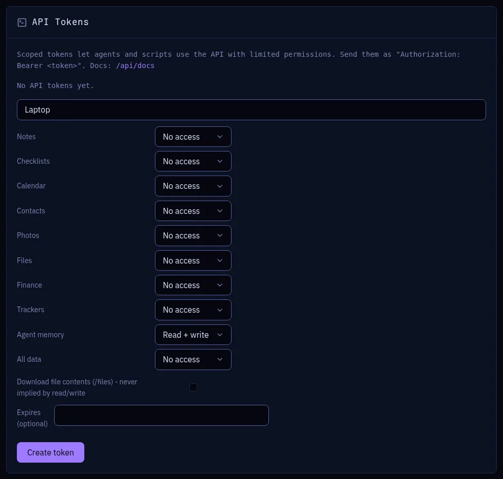

# Agent memory

**One memory for all your coding agents, on every machine.**

Claude Code and Cursor learn as you work: memory files, skills, rules. Servant keeps one shared
copy, so what your agent learned on the desktop is on the laptop the next morning, as plain
markdown that you can read and edit in the app.


The agents sync themselves with a skill and an API token: Servant never touches your disk.

## Set up a machine

1. **Create a token** in **Settings > API Tokens**, with **Agent memory** set to **Read +
   write**. One token per machine lets you revoke a lost laptop alone.

   

2. **Export it** in your shell profile (`~/.zshrc`, `~/.bashrc`):

   ```bash
   export SERVANT_URL=https://servant.example.com
   export SERVANT_TOKEN=srv_...
   ```

3. **Install the skill** for each tool:

   ```bash
   cp -r docs/skills/servant-memory ~/.claude/skills/servant-memory
   cp -r docs/skills/servant-memory ~/.cursor/skills-cursor/servant-memory
   ```

4. **Push what you have**, from each repo to share:

   ```bash
   ~/.claude/skills/servant-memory/scripts/push.sh claude \
     ~/.claude/projects/$(pwd | tr / -)/memory/*.md ~/.claude/skills/*/SKILL.md
   ```

5. **Turn on the app** in **Settings > Apps > Agent memory**.

> [!NOTE]
> The scripts need Linux (`curl`, `jq`, GNU `date`, `sha256sum`, `realpath`; not macOS) and a
> server that sends its full TLS certificate chain.

## How a session syncs

The skill makes the agent **pull** when a session starts, and **push** right after each write
of a memory file, skill or rule:

```bash
pull.sh claude              # or cursor, from the repo root
push.sh claude <file>...
```

| Local copy | What the pull does |
|------------|--------------------|
| Same | Nothing. |
| Missing | Writes the server copy. |
| Older | Writes the server copy, keeps yours as `<file>.local` and prints `MERGE`: merge them, delete the `.local`, push. |
| Newer | Leaves it alone and prints `LOCAL NEWER`: push it, or merge by hand. |

On the server, the last write wins. There is no version history.

## You have the last word

- **Delete** in the app greys the file out. Each machine deletes its copy at the next pull
  (`DELETED`), and pushes to that path fail until you **Restore** it. Once all the machines
  have synced, **Purge** removes it for good.
- **Edit** in the app wins at the next pull, even over a newer local copy (`SERVANT EDIT`), and
  the old copy stays as `.local`. The `modified` mark clears at the next agent write.

## Security

> [!WARNING]
> **A skill is an instruction that your agents follow.** Whoever can write agent memory can
> plant a skill that every machine will obey.

- Give each token **Agent memory** access only, and revoke the token of a lost machine.
- Keep secrets out of memory files: the server stores them and the app shows them.
- The pull script refuses paths outside the three trees below, and never overwrites its own
  scripts.

## Reference

### Where the files go

One entry (`kind: "agent_memory"`) per file:

| Path in Servant | Local file | Tool |
|-----------------|------------|------|
| `memory/<project>/<file>.md` | `~/.claude/projects/<mangled cwd>/memory/<file>.md` (`MEMORY.md` included) | claude |
| `skills/claude/<name>/…` | `~/.claude/skills/<name>/…` | claude |
| `skills/cursor/<name>/…` | `~/.cursor/skills-cursor/<name>/…` | cursor |
| `skills/shared/<name>/…` | the skills directory of the current tool | shared |
| `rules/<project>/<file>.mdc` | `<repo>/.cursor/rules/<file>.mdc` | cursor |

`<project>` is the name of the root folder of the repo (`servant-elixir`), so clones at
different paths share their files. `<mangled cwd>` is the absolute path of the project with `-`
for each `/`, as Claude Code names it. The server refuses other prefixes, segments outside
`[A-Za-z0-9._-]`, and `..`. Each file carries the `sha256` of its body, so a sync skips the
unchanged files without a download.

### API

The routes take the **Agent memory** scope (`app:agent_memory:read` for GET, `:write` for POST
and DELETE) or a session cookie. Schemas at `/api/docs`.

| Route | Does |
|-------|------|
| `GET /api/agent_memory?project=<name>&tool=<claude\|cursor>&include=body` | Manifest sorted by path (`path`, `project`, `tool`, `sha256`, `size`, `updated_at`, and `body` on request). `project` adds the global files, `tool` the shared ones. |
| `POST /api/agent_memory` with `{"files": [{"path": "...", "body": "..."}]}` | Upsert by path. An unchanged body writes nothing, one invalid path rejects the batch (422), a path deleted in the app gives 409. `"origin": "app"` marks the files `modified` (or restores a deleted file). |
| `DELETE /api/agent_memory?path=<path>` | Soft delete (404 if unknown). `&purge=true` removes the row. |

`/api/entries` reads these entries but cannot write them, so no client bypasses the path
checks.
