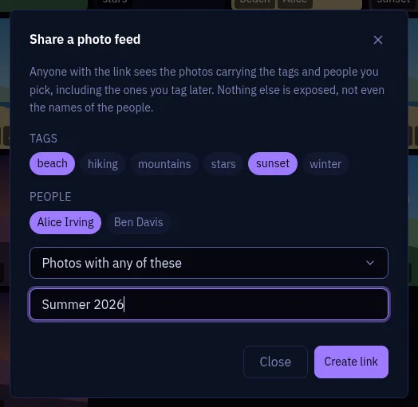
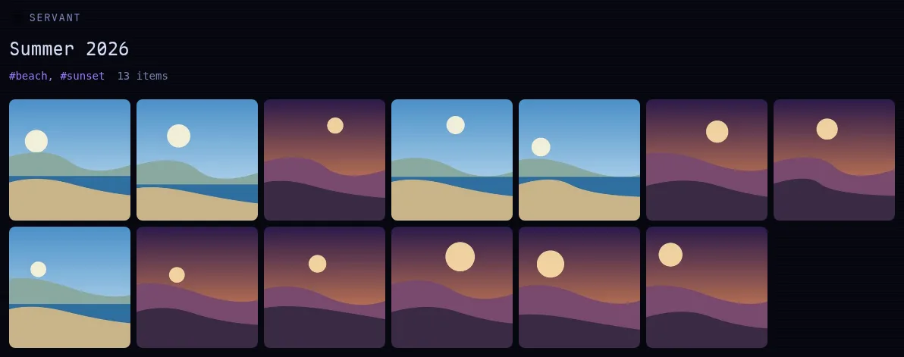

# Photo sharing

**Share a live photo feed with one link. Your guests need no account.**

Pick tags, people or both: anyone with the link sees the matching photos in a read-only
gallery. The feed stays live: tag a photo and it appears, untag it and it disappears.

## Create a link

1. In **Photos**, click **Share** (it shows once a photo has a tag or a person).
2. Pick tags, people, or both. With several, choose **any** or **all**: *Alice* + *beach* with
   **all** gives the beach photos with Alice.
3. Optionally, name the link: the name becomes the page title.
4. Click **Create link**. The URL is in your clipboard.

> [!TIP]
> Caption a photo: open it, click **Info** and type in **Note**. Your guests see the caption
> under the photo.

## Manage your links

The **Share** dialog and **Settings > API Tokens > Shared photo links** list your links, with
**Copy**, **Open** and **Revoke**. Revoking cuts access at once.

## What your guests see

**They see** the photos, newest first, in a viewer with zoom, full resolution and download,
with the title, date, media type and note of each photo.

**They never see** the location, camera, album, people or other tags, nor any file outside the
feed. A link with only people is titled "Shared photos": the page never shows names.

The page lives at `/share/<token>`. Open it yourself: you see exactly what your guests see.

## Security

> [!WARNING]
> **The link is the password.** Anyone who has it can open the gallery and forward it. Revoke
> it when the sharing is over.

- The token is 192 random bits. No session, no account.
- Tokens are stored in clear so that you can copy a link again: a database backup contains
  working links.
- Only a browser session can create or list links (`/api/photo_shares`), never an API token.
- The page reads the public route `GET /api/shares/<token>` (see `/api/docs`), which scripts
  can use too.
